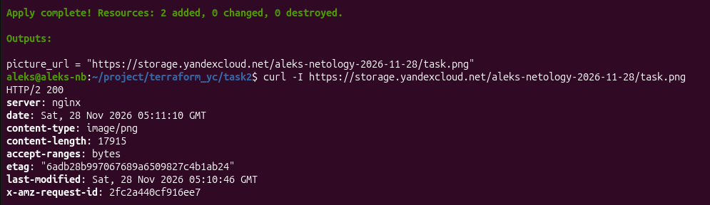
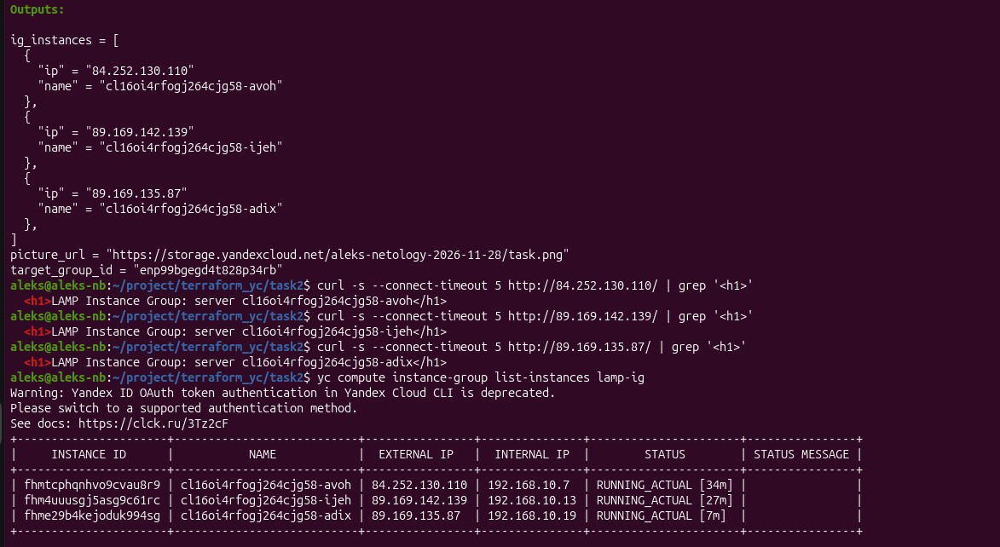
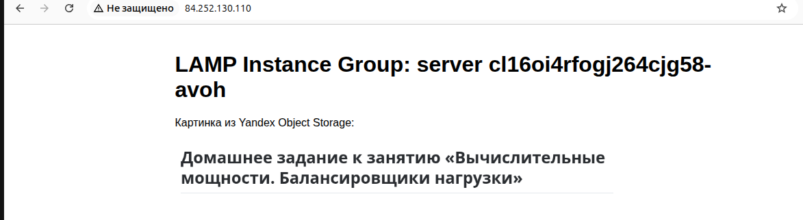
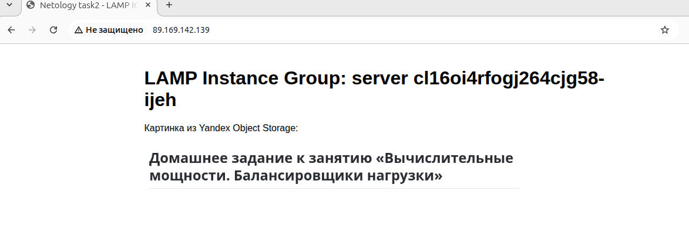
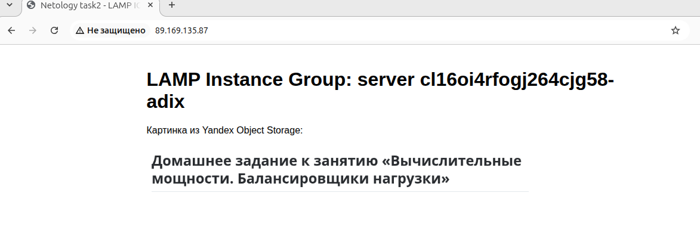
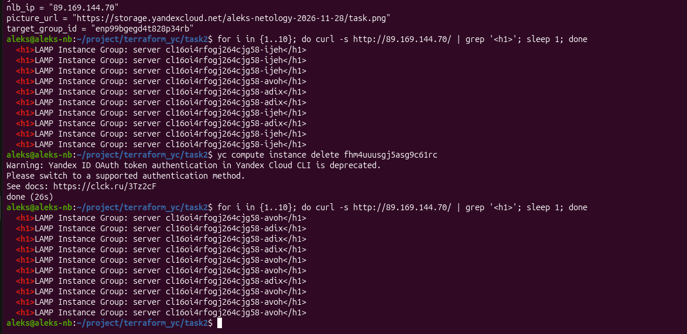

# Домашнее задание к занятию «Вычислительные мощности. Балансировщики нагрузки»

## Задание 1. Yandex Cloud

 1. Создать бакет Object Storage и разместить в нём файл с картинкой

**Решение**

 2. Создать группу ВМ в public подсети фиксированного размера с шаблоном LAMP и веб-страницей, содержащей ссылку на картинку из бакета:

**Решение**

 3. Подключить группу к сетевому балансировщику

**Решение**

